# Eyelash Corne ZMK Configuration

ZMK firmware configuration for an Eyelash Peripherals Corne keyboard.


## Flashing

| Setup | Firmware |
| --- | --- |
| Dongle / central controller | `eyeslash_corne_central_dongle_oled.uf2` |
| Left keyboard half | `eyeslash_corne_peripheral_left nice_view_custom-nice_nano_v2-zmk.uf2` |
| Right keyboard half | `eyeslash_corne_peripheral_right nice_view_custom-nice_nano_v2-zmk.uf2` |
| Settings reset (recovery only) | `nice_nano_v2-zmk.uf2` |

This configuration uses a dedicated dongle: flash the dongle, left half, and
right half with their matching files from the same build. Do not flash the
settings-reset image during a normal update; it clears the controller's stored
settings and pairings.

To flash a controller, double-tap its reset button to enter its UF2 bootloader,
then copy the matching `.uf2` file to its mounted drive. Repeat for each of the
three controllers.

## Keymap Diagram

The left home-row outer key is a mod-tap: tap for Escape, or hold for left
Shift.



## Build

Push changes to GitHub, then download the firmware ZIP from the completed
**Build ZMK firmware** GitHub Actions run.

### Local Nix build

This repository includes a Nix development shell with the ZMK toolchain:

```sh
nix develop
nix build .#firmware
```

The build produces firmware for both halves. Use `nix develop` to enter a
shell for local ZMK development.
